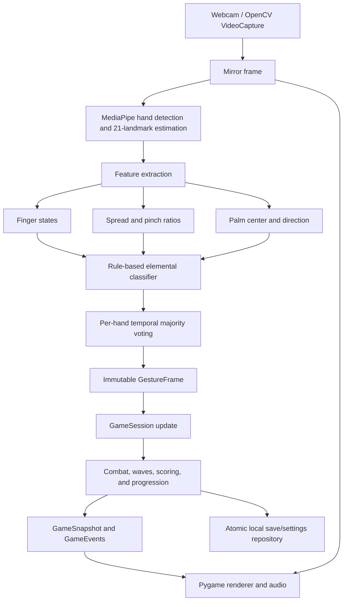

# Project Proposal and Initial Planning

## Project Title

**Elemental Convergence: A Real-Time Hand-Gesture-Controlled Action Game Using Computer Vision**

## 1. Project Overview

Elemental Convergence is a Windows-first action game in which a standard webcam becomes the main input device and the live camera image becomes the playfield. Instead of pressing keys to attack, the player performs recognizable hand poses to cast Earth, Water, Air, Fire, and Lightning powers. A two-hand pose activates the stronger Convergence ability. The player progresses through five campaign levels, restores elemental seals, fights enemies and guardians, and ultimately confronts the Rift Sovereign.

The project explores whether an ordinary RGB webcam, real-time hand-landmark detection, and lightweight geometric classification can provide a responsive and enjoyable game interface without gloves, depth cameras, or dedicated motion controllers. It combines computer vision, human-computer interaction, and game design in a complete application with calibration, difficulty settings, progression, accessibility options, and persistent saves.

## 2. Problem Statement

Most desktop games depend on a keyboard, mouse, or game controller. These devices are reliable, but they do not demonstrate how computer vision can turn natural body movement into meaningful input. Dedicated motion-control hardware can provide this experience, but it introduces extra cost and reduces accessibility for users who only have a computer and webcam.

The technical problem is to recognize a small vocabulary of visually similar hand poses from a continuous webcam stream quickly and consistently enough for action gameplay. Recognition must remain usable despite differences in hand size, position, handedness, lighting, camera quality, and background. Raw landmark predictions can also fluctuate between adjacent frames, causing false or rapidly changing commands. The game must therefore combine robust landmark estimation, scale-normalized geometric rules, temporal smoothing, calibration, and immediate visual feedback.

The design problem is equally important: motion input is not automatically intuitive or enjoyable. Research has found that motion controls can become frustrating when players must learn an unfamiliar mapping or when the interface feels unreliable [3]. Elemental Convergence addresses this risk by using a small gesture set, introducing powers progressively, providing a recognition sandbox, and retaining keyboard and mouse controls for menus.

## 3. Project Scope

### In scope

- Real-time capture from a built-in, USB, or virtual webcam.
- Detection and tracking of up to two hands.
- Recognition of five static elemental gestures.
- Two-hand proximity-and-hold detection for the Convergence ability.
- Gesture stabilization through short-window majority voting.
- Camera selection, calibration, and a no-pressure gesture sandbox.
- A finite five-level campaign with enemies, guardians, scoring, lives, and saved progression.
- Three difficulty presets and reduced-flash/reduced-shake accessibility settings.
- Automated tests that do not require a physical camera, display, or audio device.
- Packaging as a Windows desktop application.

### Out of scope

- Sign-language recognition or interpretation.
- Continuous or sentence-level dynamic gesture recognition.
- Online multiplayer, cloud accounts, or remote video processing.
- Training a new deep neural network from scratch.
- Medical, biometric, or identity-recognition use.
- Full-body pose tracking, face recognition, or emotion recognition.
- Support guarantees for mobile devices or non-Windows operating systems.

## 4. Objectives

### General objective

To design and evaluate a playable action game that uses real-time webcam-based hand-gesture recognition as its primary combat interface.

### Specific objectives

1. Capture and mirror live webcam frames using OpenCV.
2. Locate and track 21 landmarks on each visible hand using MediaPipe through cvzone.
3. Convert landmark geometry into stable finger states, hand centers, pointing directions, spread measurements, and pinch measurements.
4. Classify the five predefined elemental gestures using transparent geometric rules.
5. Reduce gesture flicker through temporal majority-vote smoothing.
6. Map recognized poses and hand positions to attacks, defense, movement-based dodging, item collection, and a two-hand ultimate ability.
7. Provide calibration and feedback that help users learn the pose vocabulary and identify unsuitable lighting or framing.
8. Separate camera processing, game rules, presentation, authored content, and persistence so that each subsystem can be tested independently.
9. Measure recognition quality, responsiveness, playability, and user experience under representative conditions.

## 5. Expected Outcomes

The project is expected to produce:

- A functioning Windows desktop game launched with `python handTrack.py --windowed` or the packaged executable.
- Recognition of Earth, Water, Air, Fire, and Lightning poses from a normal RGB webcam.
- Responsive two-hand Convergence activation that rejects one-hand and duplicate-hand detections.
- A complete 20–30 minute campaign with a clear ending, results, and credits.
- Stable gameplay despite brief landmark noise, temporary hand loss, or changes in rendering frame rate.
- Local-only processing in which camera frames are not transmitted to an external service.
- Persistent level unlocks, completion records, scores, and settings.
- A modular and documented codebase with automated unit and headless rendering tests.
- An evaluation report covering recognition accuracy, latency, frame rate, usability, and observed failure cases.

Proposed success criteria are at least **85% correct gesture recognition per pose** in controlled indoor testing, a **median gesture-to-action latency below 150 ms**, and a **median processing/display rate of at least 24 frames per second** on the target Windows hardware. These values are evaluation targets, not existing measured results.

## 6. Review of Related Literature and Systems

### 6.1 Vision-based hand-gesture interaction

Vision-based hand-gesture recognition is a form of human-computer interaction in which cameras observe hand posture or movement and software maps the observation to commands. Earlier surveys describe the field as a pipeline involving image acquisition, hand localization, feature extraction, classification, and interpretation [1, 2]. Compared with instrumented gloves, camera-based interaction is inexpensive and unobtrusive, but it must handle occlusion, changing illumination, complex backgrounds, different users, and real-time performance constraints [2].

These findings support the project's decision to limit the first version to five deliberately distinct static gestures. A small vocabulary reduces classification ambiguity and permits a transparent rule-based classifier. It also makes errors easier to diagnose than an opaque classifier trained on a small project-specific dataset.

### 6.2 MediaPipe Hands and landmark-based recognition

Zhang et al. presented MediaPipe Hands as a real-time, on-device pipeline built from a palm detector followed by a hand-landmark model [4]. The landmark model predicts 21 points in 2.5D from an RGB image. The published system uses real-world and synthetic training data and reuses landmarks from the previous frame to avoid rerunning palm detection unnecessarily [4]. This makes it suitable for responsive applications on commodity hardware.

The same paper demonstrates a simple but effective recognition strategy: determine whether fingers are bent or extended, then map combinations of finger states to predefined gestures [4]. Elemental Convergence follows this principle but adds palm-normalized distance tests, finger-spread angles, pinch distance, temporal voting, and game-specific mappings.

### 6.3 Motion controls and player experience

Movement-based games can improve immersion through natural control, movement mimicry, proprioceptive feedback, and physical challenge [5]. However, natural-looking input is not automatically better. Rogers, Bowman, and Oliver found that a motion-controlled interface could produce lower performance and greater frustration than a conventional controller when its mapping was harder to learn [3]. This is a central design consideration for Elemental Convergence.

The game therefore does not use gestures everywhere. Keyboard and mouse remain available for menus, while gestures are reserved for the combat actions where embodiment adds value. Calibration, progressive power introduction, on-screen recognition feedback, generous Story difficulty, and the Sandbox are intended to reduce the learning cost identified in the literature.

### 6.4 Contribution of the proposed project

The project is not intended to improve the MediaPipe neural network itself. Its contribution is an applied, testable integration of hand-landmark tracking with a complete game loop. In particular, it investigates whether a lightweight hybrid approach—pretrained landmark inference plus deterministic gesture rules—can support a multi-level action game on consumer hardware while remaining understandable, tunable, and privacy-preserving.

## 7. Proposed Computer Vision Approach and Algorithms

### 7.1 Processing pipeline

1. **Frame acquisition:** OpenCV `VideoCapture` requests a 1280×720 RGB camera stream. On Windows, the DirectShow backend is preferred.
2. **Preprocessing:** Each frame is mirrored horizontally so interaction behaves like a mirror.
3. **Hand detection and landmark estimation:** cvzone's `HandDetector`, backed by MediaPipe, detects up to two hands and returns 21 landmarks per hand. Detection confidence is configured at 0.8 and tracking confidence at 0.6 when supported.
4. **Scale normalization:** The distance from wrist landmark 0 to middle-finger base landmark 9 estimates hand size. Other distances are divided by this value so gesture rules are less sensitive to the player's distance from the camera.
5. **Feature extraction:** The system derives five binary finger states, mean adjacent-finger spread angle, thumb-to-index pinch ratio, palm center, pointing direction, handedness key, and confidence.
6. **Rule-based classification:** Extracted features are mapped to an elemental class.
7. **Temporal smoothing:** A seven-frame history is maintained per tracked hand. A class must receive at least four votes before it becomes the stable output.
8. **Coordinate mapping:** Hand coordinates use the same crop-and-scale transformation as the displayed camera image, keeping visible and logical positions aligned.
9. **Game integration:** An immutable `GestureFrame` is published by a background vision worker. The main Pygame loop reads the newest snapshot without blocking camera capture.

### 7.2 Gesture-classification rules

| Element/action | Intended pose | Principal rule |
| --- | --- | --- |
| Earth | Closed fist | Index, middle, ring, and little fingers are not extended |
| Water | Open palm, fingers spread | Four fingers extended and mean spread angle above the calibrated threshold |
| Air | Open palm, fingers together | Four fingers extended and mean spread angle at or below the threshold |
| Fire | Index and middle fingers raised | Index and middle extended; ring and little fingers folded; a supported pinch variant is also accepted |
| Lightning | Pointing index finger | Index extended; middle, ring, and little fingers folded |
| Convergence | Two palms brought together | Two distinct tracked hands, sufficient proximity, a full meter, and a continuous hold of approximately 0.5 seconds |

This is a **hybrid approach**: deep learning supplies robust hand landmarks, while explainable geometric and temporal algorithms perform the game-specific classification. It avoids the collection and labeling cost of training a custom network for only five poses.

### 7.3 Calibration and reliability measures

- Verify that each required elemental pose is observed above the minimum confidence threshold.
- Allow the player to try alternate camera indices.
- Keep the entire wrist and fingertips visible during calibration.
- Smooth pose changes independently for each hand.
- Report camera failure as recoverable state instead of crashing.
- Provide difficulty-dependent grace periods when hands temporarily disappear.
- Recommend even front lighting and sufficient distance from the camera.

### 7.4 Evaluation method

The initial evaluation should include at least 5 participants, with variation in hand size and skin tone where practical. Each participant should perform every pose 20 times under normal indoor lighting, producing at least 500 labeled pose attempts. Testing should also include bright backlighting, dim lighting, cluttered backgrounds, partial occlusion, left/right hands, and two-hand overlap.

The following measures will be recorded:

- Per-gesture precision, recall, and F1 score.
- Confusion matrix, especially Water versus Air and Fire versus Lightning.
- Gesture-to-action latency in milliseconds.
- Average and minimum processed frames per second.
- False activations per minute during neutral hand movement.
- Calibration completion rate and time.
- Campaign completion rate and task failures caused by recognition.
- User ratings for responsiveness, learnability, fatigue, enjoyment, and overall usability.

## 8. Initial Dataset and Image/Video Sources

The project does not require a new training dataset because it uses MediaPipe's pretrained hand-landmark model. The MediaPipe Hands paper reports that its landmark model was trained with approximately 6,000 varied in-the-wild images, 10,000 internally collected gesture images, and 100,000 rendered synthetic hand images [4]. These original training images are not redistributed by this project.

The project's initial data sources are:

| Source | Purpose | Storage and privacy |
| --- | --- | --- |
| Live webcam frames from project members/testers | Runtime input, calibration, and manual playtesting | Processed locally in memory; not saved by default |
| MediaPipe/cvzone hand landmarks | Runtime pose features | Only the latest immutable landmark snapshot is needed by the game |
| Synthetic landmark and gesture objects in `tests/` | Automated classification, smoothing, camera-failure, and mapping tests | Checked into the repository; contains no personal imagery |
| Optional consented evaluation clips | Repeatable accuracy and robustness evaluation | Collect only with written consent; store securely; delete after analysis unless further use is explicitly approved |
| Procedurally generated game imagery and optional attributed assets | Presentation and gameplay | Stored locally; asset origins and licenses documented |

If evaluation clips are collected, each clip should be assigned a participant code rather than a name. The consent form should state the purpose, retention period, authorized viewers, and withdrawal process. No facial recognition or identity inference should be performed. Public datasets are not necessary for the initial scope, but a later custom classifier would require a balanced, licensed dataset covering different users, lighting conditions, backgrounds, hand orientations, and camera devices.

## 9. System Architecture and Workflow

### Main software components

| Component | Responsibility |
| --- | --- |
| `handTrack.py` | Compatibility launcher |
| `elemental_convergence/vision.py` | Camera lifecycle, landmark processing, gesture classification, smoothing, and calibration |
| `elemental_convergence/models.py` | Shared immutable input types, coordinate mapping, and difficulty definitions |
| `elemental_convergence/session.py` | Campaign state, combat rules, waves, powers, enemies, loot, and snapshots |
| `elemental_convergence/content.py` | Validation and loading of authored level data |
| `elemental_convergence/persistence.py` | Versioned, atomic local saves and settings |
| `elemental_convergence/presentation/` | Navigation, responsive rendering, battle effects, and audio |
| `tests/` | Hardware-independent unit, integration, and rendering tests |

### Runtime data flow

The camera worker continuously publishes the most recent `GestureFrame`. The game loop consumes that snapshot with elapsed time, applies combat rules, emits game events, and produces a read-only `GameSnapshot`. Pygame draws the snapshot over the mirrored camera image. Completed levels and settings are written to versioned JSON files under the user's local application-data directory.

## 10. Proposed Technologies

| Technology | Use in the project |
| --- | --- |
| Python 3.10–3.12 | Primary programming language |
| OpenCV | Webcam access, frame capture, mirroring, and image operations |
| MediaPipe | Pretrained real-time hand detection and 21-landmark estimation |
| cvzone | Python wrapper and hand-tracking integration |
| NumPy | Landmark vectors, distances, averages, and coordinate calculations |
| Pygame | Main loop, game screens, rendering, input, and audio |
| JSON | Level definitions, saved progress, and settings |
| pytest | Automated unit and integration testing |
| PyInstaller | Windows application packaging |

## 11. Task Assignments

Replace the role labels with member names when the group is finalized. With fewer members, adjacent roles may be combined.

| Role | Suggested owner | Primary tasks |
| --- | --- | --- |
| Project lead and integration | Member 1 | Scope, schedule, repository coordination, architecture, integration, and final demonstration |
| Computer vision developer | Member 2 | Camera service, landmark features, gesture rules, smoothing, calibration, and recognition evaluation |
| Gameplay developer | Member 3 | Combat mechanics, enemies, waves, difficulty, scoring, Convergence, and balance |
| UI/UX and content developer | Member 4 | Menus, HUD, story, accessibility, audio/visual assets, level content, and player instructions |
| QA, research, and documentation | Member 5 | Literature review, test plan, participant testing, metrics, bug tracking, proposal, report, and presentation |

All members should participate in code review, weekly playtesting, risk review, and the final presentation.

## 12. Initial Project Timeline

The following eight-week plan assumes a small student team and may be adjusted to match the academic calendar.

| Week | Activities | Milestone/deliverable |
| --- | --- | --- |
| 1 | Confirm scope, assign roles, review literature, define gestures and evaluation criteria | Approved proposal and project plan |
| 2 | Set up repository and environment; implement camera capture and MediaPipe/cvzone landmark display | Webcam and hand-landmark prototype |
| 3 | Implement geometric features, five-pose classifier, smoothing, and unit tests | Stable gesture-recognition module |
| 4 | Build the core Pygame loop; map hand position/direction to powers; add calibration and Sandbox | Playable vertical slice |
| 5 | Implement campaign session, enemies, waves, guardians, loot, lives, scoring, and difficulty | Feature-complete gameplay |
| 6 | Add menus, story, HUD, accessibility settings, persistence, optional audio/art, and content validation | Complete campaign build |
| 7 | Run recognition study, usability playtests, performance profiling, balancing, and bug fixing | Test results and release candidate |
| 8 | Package for Windows, verify on clean machines/cameras, finalize documentation, report, and demonstration | Final executable, paper, and presentation |

Weekly checkpoints should review completed tasks, unresolved risks, recognition failures, test results, and the following week's assignments.

## 13. Risks and Mitigation

| Risk | Likely effect | Mitigation |
| --- | --- | --- |
| Poor or backlit room lighting | Missed landmarks or unstable poses | Calibration guidance, confidence threshold, front-lighting recommendation |
| Water and Air appear too similar | Incorrect power selection | Finger-spread angle threshold, per-user calibration, confusion-matrix testing |
| Motion blur or low-quality webcam | Delayed or missing landmarks | Moderate movement speed, sufficient lighting, supported camera selection |
| Occlusion when hands overlap | False two-hand Convergence input | Require two distinct hand keys, proximity, meter state, and continuous hold time |
| Recognition flicker | Rapid unwanted power changes | Seven-frame history with four-vote stabilization |
| Vision work blocks rendering | Low frame rate and poor responsiveness | Run camera/vision processing in a dedicated worker thread |
| Gesture fatigue | Reduced comfort and enjoyment | Short campaign, pauses, limited gesture vocabulary, difficulty options |
| Camera unavailable or disconnected | Game cannot receive combat input | Recoverable error state, camera index selection, clear troubleshooting guidance |
| Scope growth | Delayed or incomplete submission | Preserve five static gestures and five levels; defer dynamic gestures and online features |
| Privacy concerns | Participants may avoid evaluation | Local-only processing, opt-in recording, coded identifiers, defined deletion schedule |

## 14. Deliverables

1. Approved project proposal and initial plan.
2. Source code and dependency configuration.
3. Five-pose computer-vision recognition module.
4. Calibration and gesture Sandbox.
5. Playable five-level Elemental Convergence campaign.
6. Automated test suite and manual test checklist.
7. Recognition and usability evaluation results.
8. Windows executable or distributable application folder.
9. Technical documentation, user guide, final report, and presentation/demo.

## 15. References

[1] V. I. Pavlovic, R. Sharma, and T. S. Huang, “Visual Interpretation of Hand Gestures for Human-Computer Interaction: A Review,” *IEEE Transactions on Pattern Analysis and Machine Intelligence*, vol. 19, no. 7, pp. 677–695, 1997. [https://doi.org/10.1109/34.598226](https://doi.org/10.1109/34.598226)

[2] S. S. Rautaray and A. Agrawal, “Vision Based Hand Gesture Recognition for Human Computer Interaction: A Survey,” *Artificial Intelligence Review*, vol. 43, pp. 1–54, 2015. [https://doi.org/10.1007/s10462-012-9356-9](https://doi.org/10.1007/s10462-012-9356-9)

[3] R. Rogers, N. D. Bowman, and M. B. Oliver, “It’s Not the Model That Doesn’t Fit, It’s the Controller! The Role of Cognitive Skills in Understanding the Links Between Natural Mapping, Performance, and Enjoyment of Console Video Games,” *Computers in Human Behavior*, vol. 49, pp. 588–596, 2015. [https://doi.org/10.1016/j.chb.2015.03.027](https://doi.org/10.1016/j.chb.2015.03.027)

[4] F. Zhang, V. Bazarevsky, A. Vakunov, A. Tkachenka, G. Sung, C.-L. Chang, and M. Grundmann, “MediaPipe Hands: On-Device Real-Time Hand Tracking,” *arXiv preprint arXiv:2006.10214*, 2020. [https://arxiv.org/abs/2006.10214](https://arxiv.org/abs/2006.10214)

[5] M. Pasch, N. Bianchi-Berthouze, B. van Dijk, and A. Nijholt, “Movement-Based Sports Video Games: Investigating Motivation and Gaming Experience,” *Entertainment Computing*, vol. 1, no. 2, pp. 49–61, 2009. [https://doi.org/10.1016/j.entcom.2009.09.004](https://doi.org/10.1016/j.entcom.2009.09.004)

[6] OpenCV, “VideoCapture Class Reference.” [https://docs.opencv.org/4.x/d8/dfe/classcv_1_1VideoCapture.html](https://docs.opencv.org/4.x/d8/dfe/classcv_1_1VideoCapture.html)

## 16. Summary

Elemental Convergence demonstrates how computer vision can make a familiar webcam function as a low-cost game controller. Its goal is not merely to display hand landmarks, but to turn those landmarks into stable, learnable, and meaningful interaction across a complete game. The proposed hybrid design uses proven pretrained landmark tracking for perception and simple explainable rules for the project-specific gesture vocabulary. Calibration, smoothing, progressive onboarding, accessibility options, and controlled evaluation directly address the technical and human factors identified in the literature.
